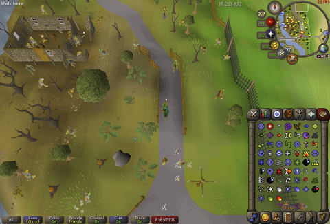

# Anime Chant

Are spells too boring for you? Just casting Fire Strike isn't exciting anymore?

**Anime Chant** makes you feel like the Main Character. When you cast a spell or perform a special attack, your
character chants the spell or spec, and can even play a sound. Chants come from bundled presets, your own
overrides, or both.



## Table of Contents

- [Features](#features)
- [Quick Start](#quick-start)
- [Sound Files](#sound-files)
- [Config Options](#config-options)
    - [Spells](#spells)
    - [Special Attacks](#special-attacks)
    - [General](#general)
- [Spell Categories](#spell-categories)
- [Custom Overrides](#custom-overrides)
- [Preset File Format (YAML)](#preset-file-format-yaml)
- [Contributing a Preset](#contributing-a-preset)
- [FAQ / Troubleshooting](#faq--troubleshooting)

## Features

- Overhead text when casting spells and when using special attacks.
- Bundled presets: Fantasy, Anime Mix, Frieren, Palworld, Demon Slayer and more.
- Per-spell, per-category and per-weapon overrides.
- Fallback to spell or spec name if no custom text isp resent.
- Optional sounds (`.wav`) for spells and special attacks.
- Anti-spam controls for spells. Helps with auto-casting spam.

## Quick Start

1. Enable **Anime Chant** in the RuneLite plugin hub.
2. Open the plugin settings and pick a **Spell Text Preset**.
3. Cast a spell.
4. (Optional) Add your own text with [Custom Overrides](#custom-overrides).

## Sound Files

Sound files are not included by default. You can download some presets I've collected and manually put them in the
plugin-data directory.

<!-- TODO: add step-by-step of sound files. -->

## Config Options

### Spells


#### Enable Spell Chanting

Displays a chant when casting spells. Nothing is displayed when disabled.

Default: enabled

#### Spell Text Preset

Choose from a list of pre-made spell-to-text conversions. For the full lists, refer to the
[GitHub repo](https://github.com/aguscerdo/runelite-anime-chants/tree/master/src/main/resources/com/aguscerdo/animechant/chantdata).

These presets can be edited in the runlite plugin data (`.runelite/plugin-data/anime-chant`).

| Preset         | Description                                                                                      |
|----------------|--------------------------------------------------------------------------------------------------|
| `None`         | No presets, only overrides.                                                                      |
| `Spell Name`   | Chants the name of the spell, e.g. "High Level Alchemy".                                         |
| `Fantasy`      | Basic fantasy spell names, e.g. "Fireball".                                                      |
| `Anime Mix`    | A mix of many anime series, e.g. "Arise...", "Zoltraak", "Explosion".                            |
| `Frieren`      | Spell names from *Frieren*, e.g. "Zoltraak", "Sorganeil".                                        |
| `Palworld`     | Palworld skills, e.g. "Hydro Jet", "Ignis Blast".                                                |
| `Demon Slayer` | Breathing stances and Blood Demon Arts, e.g. "Water Breathing, First Form: Water Surface Slash". |
| `User Custom`  | A custom file for you to edit.                                                                   |

Your [overrides](#custom-overrides) always take priority over the preset.

Default: `Fantasy`

#### Custom Spell Overrides

Custom text and sounds for individual spells or whole [spell categories](#spell-categories).
See [Custom Overrides](#custom-overrides) for the full syntax.

Default: empty

#### Fall back to Spell Name

If enabled, chants the spell's name when no text is found in the preset or your overrides. This gives text coverage
to spells outside presets and overrides.

Default: enabled

#### Shout Spells

Appends a `!` to the text. Text already ending in `.` or `!` is left unchanged.

Wanna feel like Asta?

Default: disabled

#### Spell Sounds

Plays the configured sound (if any) when chanting a spell. See [Sound Volume](#sound-volume).

Default: disabled

#### Spell text delay (ticks)

Hides text if the same spell or category **showed text** fewer than `N` ticks ago.

Useful for avoiding spam on auto-cast. For example, with 10 ticks, a spell's text is not displayed again until 10
ticks have passed since it was last displayed.

Default: 0

#### Spell text delay from last cast (ticks)

Hides text if the same spell or category was **cast** fewer than `N` ticks ago, even if that cast showed nothing.
Spell-name text and category text are tracked separately.

Useful for showing text only the first time a spell is cast in a streak, for example only when initiating combat
with a Fire Wave auto-cast.

Default: 0

> **Delay vs. delay from last cast:** the first only counts casts that actually displayed text; the second counts
> every cast.

<!-- TODO: Short GIF comparing auto-cast with and without a delay -->


### Special Attacks

<!-- TODO: Screenshot of the Special Attacks config section -->


#### Enable Special Attack Chanting

Displays a chant when you perform a special attack.

Default: enabled

#### Spec Text Preset

Bundled list of special attack text. Your overrides always take priority. For the full lists, refer to the
[GitHub repo](https://github.com/aguscerdo/runelite-anime-chants/tree/master/src/main/resources/com/aguscerdo/animechant/chantdata).

These presets can be edited in the runlite plugin data (`.runelite/plugin-data/anime-chant`).

| Value         | Behavior                              |
|---------------|---------------------------------------|
| `NONE`        | None.                                 |
| `Anime Mix`   | A mix of phrases from anime.          |
| `User Custom` | A user custom preset for you to edit. |

Default: `None`

#### Spec Fallback

What to chant when no preset or override matches.

| Value                 | Behavior                                                             |
|-----------------------|----------------------------------------------------------------------|
| `NONE`                | No fallback.                                                         |
| `SPECIAL_ATTACK_NAME` | The name of the special attack, e.g. "Quick smash" for Granite Maul. |
| `WEAPON_NAME`         | The name of the weapon, e.g. "Excalibur", "Abyssal whip".            |

Default: `SPECIAL_ATTACK_NAME`

#### Spec Overrides

Custom text and sounds per weapon, keyed by weapon name or item ID. See [Custom Overrides](#custom-overrides).

Default: empty

#### Shout Specs

Appends a `!` to the text. Text already ending in `.` or `!` is left unchanged.

Default: disabled

#### Special Attack Sounds

Plays the configured sound (if any) when performing a special attack.

Default: disabled


### General

#### Sound Volume

Volume of chant sounds.

* Default: 30
* Minimum: 0
* Maximum: 100

#### Display duration (ticks)

How many ticks the text stays above your head.

* Default: 3
* Minimum: 3
* Maximum: 15

#### Scratchpad (no effect)

A convenient place to copy and paste stuff, such as presets you like. It is not used by the plugin.

#### [Reload preset files]

Rewrites the plugin's preset files from the bundled versions and reloads them. The reload triggers when the
checkbox is toggled on or off.

These presets can be edited in the runlite plugin data (`.runelite/plugin-data/anime-chant`).

> **Warning:** this overwrites the preset files in the plugin directory. Changes you made to them will be lost.
> Use [overrides](#custom-overrides) for personal tweaks instead.

## Spell Categories

A category groups related spells so one entry can cover all of them. Categories are usable in
[Custom Overrides](#custom-overrides) and as keys under `spell_categories` in
[preset files](#preset-file-format-yaml). Names are case-insensitive, and spaces are treated as underscores
(`Charge Orb` and `charge_orb` are the same).

| Category     | Spellbook | Covers                                   |
|--------------|-----------|------------------------------------------|
| `TELEPORT`   | General   | Teleport spells                          |
| `TELE_OTHER` | General   | Teleport Other spells                    |
| `TELE_GROUP` | General   | Teleport Group spells                    |
| `AIR`        | Standard  | Air combat spells                        |
| `WATER`      | Standard  | Water combat spells                      |
| `EARTH`      | Standard  | Earth combat spells                      |
| `FIRE`       | Standard  | Fire combat spells                       |
| `GOD`        | Standard  | God spells                               |
| `BIND`       | Standard  | Bind, Snare, Entangle                    |
| `ALCHEMY`    | Standard  | Low and High Level Alchemy               |
| `CURSE`      | Standard  | Curse spells (Confuse, Weaken, Curse...) |
| `ENCHANT`    | Standard  | Jewelry and bolt enchanting              |
| `CHARGE_ORB` | Standard  | Charge Orb spells                        |
| `SHADOW`     | Ancient   | Shadow spells                            |
| `SMOKE`      | Ancient   | Smoke spells                             |
| `BLOOD`      | Ancient   | Blood spells                             |
| `ICE`        | Ancient   | Ice spells                               |
| `GRASP`      | Arceuus   | Grasp spells                             |
| `DEMONBANE`  | Arceuus   | Demonbane spells                         |
| `THRALL`     | Arceuus   | Resurrect Thrall spells                  |
| `REANIMATE`  | Arceuus   | Reanimation spells                       |
| `OFFERING`   | Arceuus   | Bone/ensouled head offering spells       |
| `CORRUPTION` | Arceuus   | Corruption spells                        |
| `CURE`       | Lunar     | Cure spells                              |
| `HEAL`       | Lunar     | Heal spells                              |
| `VENGEANCE`  | Lunar     | Vengeance spells                         |

## Custom Overrides

| Line format          | Meaning                                                  |
|----------------------|----------------------------------------------------------|
| `Name=Text`          | Text to display for a spell, category or weapon.         |
| `Name file=path.wav` | Sound file for that name, relative to the plugin folder. |

Spell overrides (and spec overrides) are written one entry per line, as `name=value`:

```
fire strike=Single Spell Text
fire strike file=Single Spell File.wav
Demonbane=Spell Category Text
Demonbane=Additional text entry
```

For special attacks, the name is the weapon name or its item ID:

```
abyssal whip=Lash!
abyssal whip file=whip.wav
4151=Lash!
4151 file=whip.wav
```

**Usage notes:**

- Multiple entries with the same name will all be used.
    - e.g. two Fire Strike lines are both accepted, and text is chosen randomly each time.
- Multiple file paths for the same spell, category or weapon are applied in order.
    - For example, the block below is equivalent to:<br>
      `(demonbane -> (text1, file1.wav), demonbane -> (text2, file2.wav))`.

  ```
  demonbane=text1
  demonbane=text2
  demonbane file=file1.wav
  demonbane file=file2.wav
  ```

- User overrides take priority over preset data and fallback names.
- Setting a spell to `None` or leaving it **empty** disables it.
- Invalid lines are ignored.


## Preset File Format (YAML)

Presets are YAML files bundled with the plugin (see the
[chantdata folder](https://github.com/aguscerdo/runelite-anime-chants/tree/master/src/main/resources/com/aguscerdo/animechant/chantdata)).
This is the current schema, **version 1**.

### Example

This is the bundled Frieren preset:

```yaml
version: 1
name: Anime Mix
spell_sound_directory: anime_mix/spells
spell_categories:
  fire:
    - text: "Explooooooosiooooon!!"
      sound: "explosion.wav"
  air:
    - text: "Luminous Wind!"
      sound: "luminous_wind.wav"
  earth:
    - "Stone Cannon"
  water:
    - "Water Breathing, Fourth Form: Striking Tide!"
  ice:
    - "El Minya!"
  blood:
    - "Blood Demon Arts: Exploding Blood!"
  shadow:
    - text: "I am... Ā ť ø m î ċ"
      sound: "atomic.wav"
  smoke:
    - "Moku Moku no Mi: Howaito Sunēku"
  grasp:
    - "Bakudō #61. Rikujōkōrō"
  demonbane:
    - text: "Zoltraak"
      sound: "zoltrak.wav"
  thrall:
    - text: "Arise..."
      sound: "arise.wav"
  alchemy:
    - "Equivalent Exchange"
  teleport:
    - "Truck-kun!"

```

### Top-level fields

| Field                         | Required | Description                                                                           |
|-------------------------------|----------|---------------------------------------------------------------------------------------|
| `version`                     | Yes      | Schema version. Currently `1`.                                                        |
| `name`                        | Yes      | Display name of the preset.                                                           |
| `spell_sound_directory`       | No       | Directory that spell sound files are resolved against from plugin directory.          |
| `spec_weapon_sound_directory` | No       | Directory that special attack sound files are resolved against from plugin directory. |
| `spell_categories`            | No       | Map of [spell category](#spell-categories) to a list of text entries.                 |
| `spells`                      | No       | Map of individual spell to a list of text entries.                                    |
| `spec_weapons`                | No       | Map of weapon to a list of text entries.                                              |

### Text entries

Each key maps to a **list** of entries. If a key has several entries, one is chosen at random each time it triggers.
Each entry has display text and, optionally, a sound file. The sound path is resolved against the matching
`*_sound_directory` when one is set.

```yaml
spells:
  fire_strike:
    - "Burn!"                   # text only
    - text: "Flames, answer me" # text with a sound
      sound: "flames.wav"
```

### Lookup order

For a given spell, text is looked up in this order:

1. Your [custom overrides](#custom-overrides)
2. The selected preset (individual spell, then spell category)
3. Fallback, either spell name, spec attack name or spec weapon name.

## Contributing a Preset

If you have a really cool preset, that is the coolest thing ever, create a new pull request with it.